<picture>
  <source media="(prefers-color-scheme: dark)" srcset="https://raw.githubusercontent.com/narayan-nkj/narayan-nkj/main/assets/banner-dark.svg">
  
</picture>

## Focus

Student engineer building acoustic signal intelligence, deterministic verification gates, and digital-twin systems. Studying Data Science at IIT Madras alongside Computer Science at B.P. Poddar Institute of Management & Technology.

- Mathematical foundations in linear algebra, numerical analysis, and acoustic signal modeling.
- High-throughput verification pipelines with fail-closed semantics and immutable audit trails.
- Digital twin simulation architectures for remote telemetry in extreme environments.

<picture>
  <source media="(prefers-color-scheme: dark)" srcset="https://raw.githubusercontent.com/narayan-nkj/narayan-nkj/main/assets/divider-noisy-dark.svg">
  
</picture>

## Engineering

### [S.A.G.A.R. (Ocean-X)](https://github.com/narayan-nkj/SagaRSonaR)
AI-assisted seabed survey analysis featuring a 14-stage acoustic anomaly processing pipeline for side-scan sonar imagery under low signal-to-noise ratios. Built for Smart India Hackathon 2026 (Problem Statement 26057).
- **Stack:** Python &bull; FastAPI &bull; PyTorch &bull; React 19 &bull; MapLibre GL
- **Links:** [Repository](https://github.com/narayan-nkj/SagaRSonaR) &bull; [Sonar Dataset on Hugging Face](https://huggingface.co/datasets/narayan-nkj/sagar-sss)

### [ClaimCheck](https://github.com/narayan-nkj/claimcheck-retail-media)
Deterministic pre-publication verification gate that checks factual claims in retail advertising copy against merchant data. Enforces a fail-closed verdict taxonomy (`ALLOW`, `REVIEW`, `BLOCK`) with immutable audit logging and sub-millisecond local policy execution.
- **Stack:** Node.js &bull; TypeScript &bull; Express
- **Links:** [Repository](https://github.com/narayan-nkj/claimcheck-retail-media) &bull; [Live Application](https://claimcheck-ruddy-nu.vercel.app) &bull; [Local Benchmarks](https://github.com/narayan-nkj/claimcheck-retail-media#performance--benchmarks)

<b>More Projects (4)</b>

 

#### [NCPOR Polar Twin](https://github.com/narayan-nkj/SIH26060)
Digital-twin operations platform for remote telemetry monitoring, predictive alerting, and supply synchronization across India's Antarctic research stations (Maitri and Bharati) for SIH 2026.
- **Stack:** React &bull; Vite &bull; Node.js &bull; Express &bull; MongoDB
- **Links:** [Repository](https://github.com/narayan-nkj/SIH26060) &bull; [Live Platform](https://ncporpolartwin.vercel.app)

#### [PhantomDeps](https://github.com/narayan-nkj/phantomdeps)
Verification-only pre-install gate for IBM Bob that statically inspects exported AST declarations from npm tarballs before installation to neutralize AI-agent package hallucinations.
- **Stack:** TypeScript &bull; Node.js 20+ &bull; SHA-256 Chaining
- **Links:** [Repository](https://github.com/narayan-nkj/phantomdeps) &bull; [Product Contract](https://github.com/narayan-nkj/phantomdeps/blob/main/docs/product-contract.md)

#### [TaskFlow](https://github.com/narayan-nkj/Taskflow)
Student productivity engine and academic deadline workspace with a 7-day strip scheduler and isolated sample data feeds.
- **Stack:** React 18 &bull; TypeScript &bull; Vite &bull; Tailwind CSS
- **Links:** [Repository](https://github.com/narayan-nkj/Taskflow) &bull; [Live Application](https://taskflow-five-nu-26.vercel.app)

#### [Portfolio Suite](https://github.com/narayan-nkj/Narayan.nkj)
Personal engineering portfolio and project showcase with minimalist typography and theme switching.
- **Stack:** HTML5 &bull; CSS3 &bull; TypeScript &bull; JavaScript
- **Links:** [Repository](https://github.com/narayan-nkj/Narayan.nkj) &bull; [Live Site](https://narayan-nkj.vercel.app)

<picture>
  <source media="(prefers-color-scheme: dark)" srcset="https://raw.githubusercontent.com/narayan-nkj/narayan-nkj/main/assets/divider-mid-dark.svg">
  
</picture>

## Stack

- **Core:** Python, TypeScript, JavaScript, C/C++, SQL
- **Systems & Backend:** FastAPI, Node.js, Express, Redis, SQLite
- **Frontend & Visualization:** React, Vite, Tailwind CSS, MapLibre GL, Three.js
- **ML & Signal Processing:** PyTorch, Hugging Face, OpenCV, NumPy, SciPy, scikit-learn, pandas
- **Tooling & Infrastructure:** Git, Docker, GitHub Actions, Linux
- *Also used:* Shell, Makefile, HTML5 Canvas

<picture>
  <source media="(prefers-color-scheme: dark)" srcset="https://raw.githubusercontent.com/narayan-nkj/narayan-nkj/main/assets/languages-dark.svg">
  
</picture>

 

<picture>
  <source media="(prefers-color-scheme: dark)" srcset="https://raw.githubusercontent.com/narayan-nkj/narayan-nkj/main/assets/contribution-waveform-dark.svg">
  
</picture>

<picture>
  <source media="(prefers-color-scheme: dark)" srcset="https://raw.githubusercontent.com/narayan-nkj/narayan-nkj/main/assets/divider-sine-dark.svg">
  
</picture>

## Contact

- **Open to:** internships / research / hackathon teams
- **Location:** India (IST / UTC+5:30)
- **Portfolio:** [narayan-nkj.vercel.app](https://narayan-nkj.vercel.app)
- **Email:** [narayan.nkj@gmail.com](mailto:narayan.nkj@gmail.com)
- **LinkedIn:** [narayan-nkj](https://www.linkedin.com/in/narayan-nkj)
- **Instagram:** [n.jha.__](https://www.instagram.com/n.jha.__)
