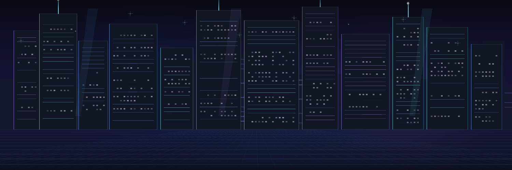

<div align="center">



# Narayan Kumar Jha

**Systems Engineer & Creative Developer | Data Science & Distributed Architecture**

[](https://github.com/narayan-nkj)
[](https://github.com/narayan-nkj)
[](https://study.iitm.ac.in/ds/)
[](https://bppimt.ac.in)
[](https://www.instagram.com/narayan.mindmaster?igsh=MTI4enN0ZHM5MHVsZA==)
[](https://narayan-nkj.vercel.app)

<br/>

> *Architecting mission-critical platforms, acoustic signal intelligence pipelines, and deterministic verification gates with mathematical rigor and clean systems design.*

</div>

---

### 🛰️ About Me

I am a dual-track computer science and data science scholar bridging theoretical mathematical foundations with high-throughput production engineering:

- 🎓 **Academics:** Pursuing a **BS in Data Science at Indian Institute of Technology Madras (IIT Madras)** alongside Computer Science coursework at **B.P. Poddar Institute of Management & Technology**.
- 🔬 **Core Focus:** Linear algebra & numerical computing, high-performance distributed systems, deterministic software verification, and acoustic signal intelligence.
- ⚡ **Engineering Principles:** Fail-closed security architecture, sub-millisecond pipeline latency, rigorous type safety, and mathematically verifiable contracts.
- 🔭 **Current Explorations:** High-throughput streaming architectures, AST-level software supply chain defenses, underwater side-scan sonar image telemetry, and digital twins for extreme polar environments.

---

### 🛠️ Technology Ecosystem

```
Core Languages      │ Python 3.12+ • TypeScript • JavaScript (ESNext) • C/C++ • SQL
Backend & Systems   │ FastAPI • Node.js • Express • Asyncio • WebSockets • Redis • SQLite
Frontend & UI/UX    │ React 18/19 • Vite • Tailwind CSS • MapLibre GL • Three.js • HTML5 Canvas
AI & Signal Ops     │ PyTorch • Hugging Face • OpenCV • NumPy • SciPy • Scikit-learn • Pandas
DevOps & Tooling    │ Git • Docker • GitHub Actions CI/CD • Linux / Shell • Make • Postman
```

---

### 🚀 Featured Engineering Projects

<table>
  <tr>
    <td width="50%" valign="top">
      <h3 align="left">🌊 S.A.G.A.R. — Ocean-X</h3>
      <p><b>AI-Assisted Seabed Survey Analysis & 14-Stage Acoustic Anomaly Intelligence</b></p>
      <p>Developed for the Smart India Hackathon (SIH 2026, Problem Statement 26057). An end-to-end underwater reconnaissance and sidescan sonar processing suite capable of multi-stage acoustic filtering, bathymetric mapping, and automated anomaly classification under low signal-to-noise marine environments.</p>
      <p><b>Tech Stack:</b> Python, FastAPI, PyTorch, React 19, MapLibre GL, Hugging Face</p>
      <p>
        <a href="https://github.com/narayan-nkj/SagaRSonaR"><b>Repository ↗</b></a> &nbsp;|&nbsp;
        <a href="https://huggingface.co/datasets/narayan-nkj/sagar-sss"><b>Sonar Dataset ↗</b></a>
      </p>
    </td>
    <td width="50%" valign="top">
      <h3 align="left">🛡️ ClaimCheck — Retail Media Verification Gate</h3>
      <p><b>Deterministic Pre-Publication Verification Gate for Advertising Factual Assertions</b></p>
      <p>A high-performance pre-publication evidence gate designed to prevent misleading claims in retail media advertising. Enforces a strict, fail-closed verdict taxonomy (<code>ALLOW</code>, <code>REVIEW</code>, <code>BLOCK</code>) with sub-millisecond policy evaluation, 77k+ ops/sec throughput, and immutable audit logging.</p>
      <p><b>Tech Stack:</b> Node.js, TypeScript, Express, AMD ROCm / MI300X, Tailwind CSS</p>
      <p>
        <a href="https://github.com/narayan-nkj/claimcheck-retail-media"><b>Repository ↗</b></a> &nbsp;|&nbsp;
        <a href="https://claimcheck-ruddy-nu.vercel.app"><b>Live Application ↗</b></a>
      </p>
    </td>
  </tr>
  <tr>
    <td width="50%" valign="top">
      <h3 align="left">🧊 NCPOR Polar Twin</h3>
      <p><b>Antarctic Operations Command & Digital Twin Logistics Platform</b></p>
      <p>A full-stack digital twin platform engineered for remote management and telemetry monitoring of India’s Antarctic research stations (Maitri & Bharati) for SIH 2026. Features real-time environmental telemetry, predictive critical alerts, role-based logistics workflows, and supply-chain synchronization.</p>
      <p><b>Tech Stack:</b> React, Vite, Node.js, Express, MongoDB, Tailwind CSS</p>
      <p>
        <a href="https://github.com/narayan-nkj/SIH26060"><b>Repository ↗</b></a> &nbsp;|&nbsp;
        <a href="https://ncporpolartwin.vercel.app"><b>Live Platform ↗</b></a>
      </p>
    </td>
    <td width="50%" valign="top">
      <h3 align="left">🔐 PhantomDeps</h3>
      <p><b>Pre-Install Static AST AI Dependency Claim Gate for IBM Bob</b></p>
      <p>An npm-first, verification-only pre-install gate designed to neutralize AI coding agent package and symbol hallucinations. Statically inspects exported AST declarations directly from tarballs before execution, enforcing a five-dimensional provenance chain and SHA-256 tamper-evident decision logs.</p>
      <p><b>Tech Stack:</b> TypeScript 5.5+, Node.js 20+, AST Parsers, SHA-256 Chaining</p>
      <p>
        <a href="https://github.com/narayan-nkj/phantomdeps"><b>Repository ↗</b></a> &nbsp;|&nbsp;
        <a href="https://github.com/narayan-nkj/phantomdeps/blob/main/docs/product-contract.md"><b>Product Contract ↗</b></a>
      </p>
    </td>
  </tr>
  <tr>
    <td width="50%" valign="top">
      <h3 align="left">⚡ TaskFlow</h3>
      <p><b>Focused Student Productivity Engine & Deadline Inspector</b></p>
      <p>A calm, dependable productivity workspace built to unify academic deadlines, hackathon deliverables, and student developer workflows. Engineered with zero extraneous cognitive overhead, responsive 7-day date strip scheduling, and isolated external API synchronization.</p>
      <p><b>Tech Stack:</b> React 18, TypeScript, Vite, Tailwind CSS</p>
      <p>
        <a href="https://github.com/narayan-nkj/Taskflow"><b>Repository ↗</b></a> &nbsp;|&nbsp;
        <a href="https://taskflow-five-nu-26.vercel.app"><b>Live App ↗</b></a>
      </p>
    </td>
    <td width="50%" valign="top">
      <h3 align="left">🌐 Portfolio Suite</h3>
      <p><b>Personal Engineering & Creative Developer Showcase</b></p>
      <p>An interactive, responsive digital portfolio highlighting full-stack architectures, data science research, algorithmic proofs, and production deployments with smooth transitions and editorial design aesthetics.</p>
      <p><b>Tech Stack:</b> HTML5, CSS3, TypeScript, JavaScript, Vercel</p>
      <p>
        <a href="https://github.com/narayan-nkj/Narayan.nkj"><b>Repository ↗</b></a> &nbsp;|&nbsp;
        <a href="https://narayan-nkj.vercel.app"><b>Live Experience ↗</b></a>
      </p>
    </td>
  </tr>
</table>

---

### 📊 Engineering Activity & Insights

<div align="center">
  <table border="0">
    <tr>
      <td align="center" valign="middle">
        <a href="https://github.com/narayan-nkj">
          
        </a>
      </td>
      <td align="center" valign="middle">
        <a href="https://github.com/narayan-nkj">
          
        </a>
      </td>
    </tr>
  </table>
  <br/>
  <a href="https://github.com/narayan-nkj">
    
  </a>
</div>

---

### 📡 Connect & Collaborate

<div align="center">

```
  Location     │  India (IST / UTC+5:30)
  GitHub       │  https://github.com/narayan-nkj
  Portfolio    │  https://narayan-nkj.vercel.app
  Instagram    │  https://www.instagram.com/narayan.mindmaster
  Education    │  IIT Madras (BS in Data Science) & B.P. Poddar Institute
```

<br/>

*“The craft of engineering lies in turning mathematical beauty into dependable, unyielding reality.”*

</div>
