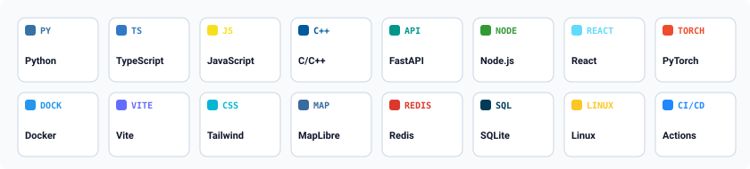
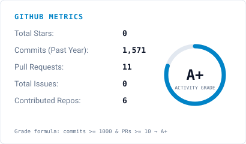
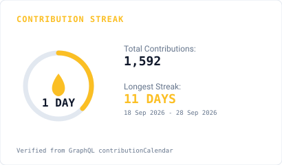
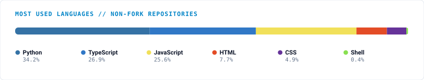
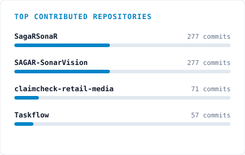
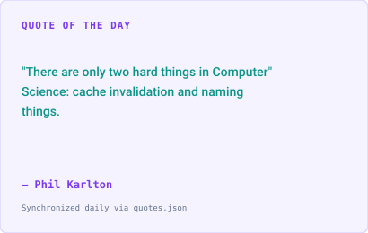

<picture>
  <source media="(prefers-color-scheme: dark)" srcset="https://raw.githubusercontent.com/narayan-nkj/narayan-nkj/main/assets/pixel-banner-dark.svg">
  
</picture>

<picture>
  <source media="(prefers-color-scheme: dark)" srcset="https://raw.githubusercontent.com/narayan-nkj/narayan-nkj/main/assets/pixel-headline-dark.svg">
  
</picture>

---

<b>Namaste, I'm Narayan Kumar Jha</b>

---

## 👾 About Me

> **Status:** 🛰️ *Telemetry synchronized &bull; India (IST)* &nbsp;|&nbsp; 🎓 *BS in Data Science @ IIT Madras &bull; CSE @ B.P. Poddar Institute*

 

<table border="0" width="100%">
  <tr>
    <td width="65%" valign="top">
      <ul>
        <li>🎓 <b>Degree Path:</b> Pursuing BS in Data Science at IIT Madras alongside Computer Science at BPPIMT.</li>
        <li>🌊 <b>What I'm Building:</b> S.A.G.A.R. (Ocean-X) &mdash; 14-stage acoustic anomaly pipeline for sonar (SIH 2026 PS 26057).</li>
        <li>🛡️ <b>Core Interests:</b> Linear algebra, high-throughput systems, and deterministic verification gates.</li>
        <li>💬 <b>Ask Me About:</b> Fail-closed claim verification, AST-level dependency gates, and digital twin simulation platforms.</li>
        <li>🔭 <b>Exploring Now:</b> Extreme polar telemetry and acoustic signal denoising under low signal-to-noise ratios.</li>
        <li>⚡ <b>Open To:</b> <code><<CONFIRM: internships / research / hackathon teams>></code></li>
      </ul>
    </td>
    <td width="35%" align="center" valign="middle">
      <picture>
        <source media="(prefers-color-scheme: dark)" srcset="https://raw.githubusercontent.com/narayan-nkj/narayan-nkj/main/assets/pixel-about-dark.svg">
        
      </picture>
    </td>
  </tr>
</table>

  <b>Follow me on:</b> &nbsp;
  
  
  
  
  
  

---

## 🛠️ Languages & Tools

  <picture>
    <source media="(prefers-color-scheme: dark)" srcset="https://raw.githubusercontent.com/narayan-nkj/narayan-nkj/main/assets/pixel-tiles-dark.svg">
    
  </picture>

---

## 📊 GitHub Stats

<table border="0" width="100%">
  <tr>
    <td width="50%" align="center" valign="top">
      <picture>
        <source media="(prefers-color-scheme: dark)" srcset="https://raw.githubusercontent.com/narayan-nkj/narayan-nkj/main/assets/stats-card-dark.svg">
        
      </picture>
    </td>
    <td width="50%" align="center" valign="top">
      <picture>
        <source media="(prefers-color-scheme: dark)" srcset="https://raw.githubusercontent.com/narayan-nkj/narayan-nkj/main/assets/streak-card-dark.svg">
        
      </picture>
    </td>
  </tr>
</table>

  <picture>
    <source media="(prefers-color-scheme: dark)" srcset="https://raw.githubusercontent.com/narayan-nkj/narayan-nkj/main/assets/languages-card-dark.svg">
    
  </picture>

---

## 💻 Tech Stack

       
        
       
       
     

---

<table border="0" width="100%">
  <tr>
    <td width="50%" align="center" valign="top">
      <h3>🏆 Top Contributed Repo</h3>
      <picture>
        <source media="(prefers-color-scheme: dark)" srcset="https://raw.githubusercontent.com/narayan-nkj/narayan-nkj/main/assets/contributors-card-dark.svg">
        
      </picture>
    </td>
    <td width="50%" align="center" valign="top">
      <h3>💬 Quote of the Day</h3>
      <picture>
        <source media="(prefers-color-scheme: dark)" srcset="https://raw.githubusercontent.com/narayan-nkj/narayan-nkj/main/assets/quote-card-dark.svg">
        
      </picture>
    </td>
  </tr>
</table>

---

## 🤝 Collaborate

Interested in collaborating on acoustic signal processing, verification gates, or high-performance systems?

  

<picture>
  <source media="(prefers-color-scheme: dark)" srcset="https://raw.githubusercontent.com/narayan-nkj/narayan-nkj/main/assets/closing-strip-dark.svg">
  
</picture>

